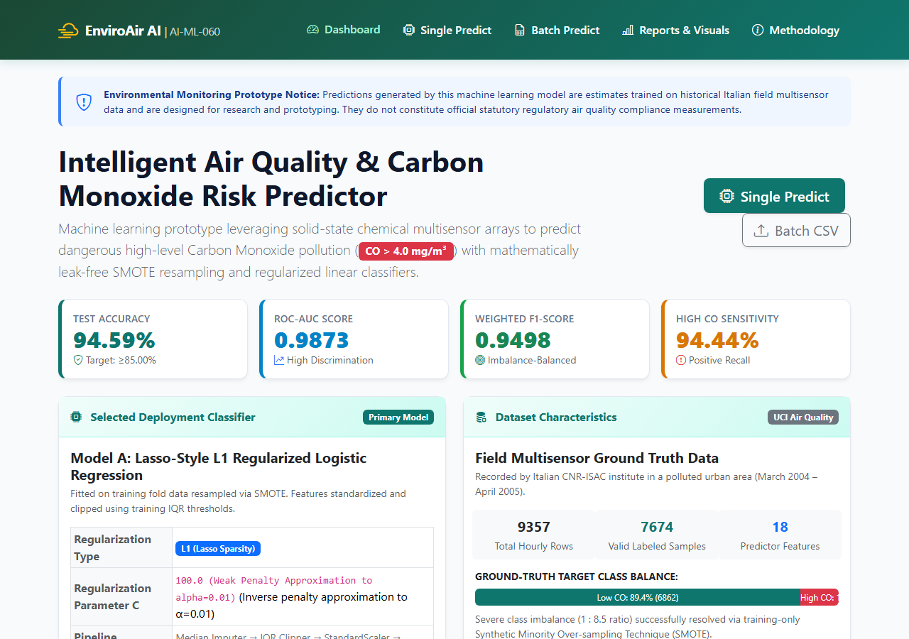
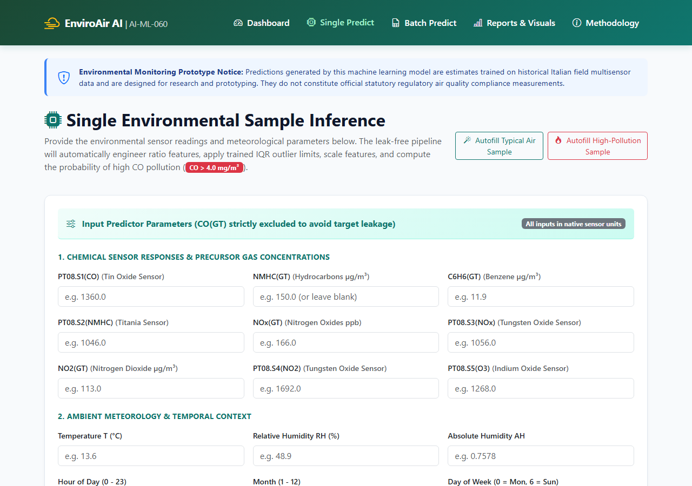
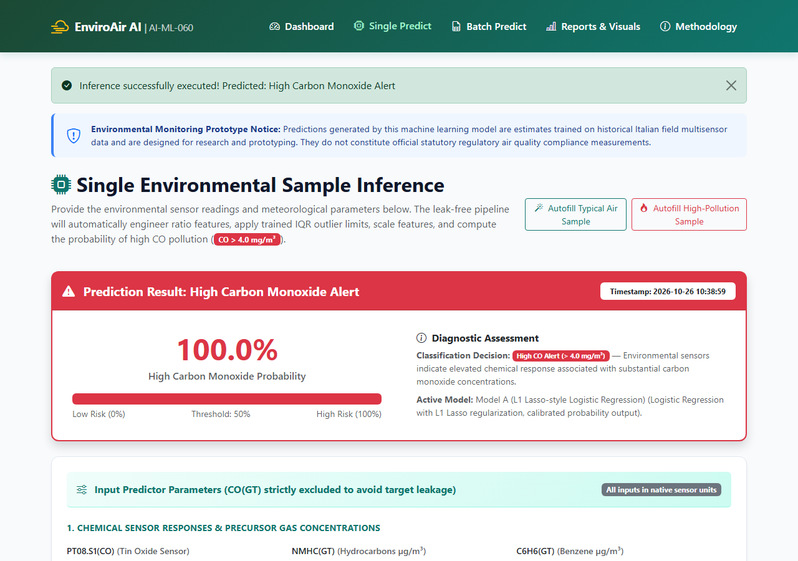
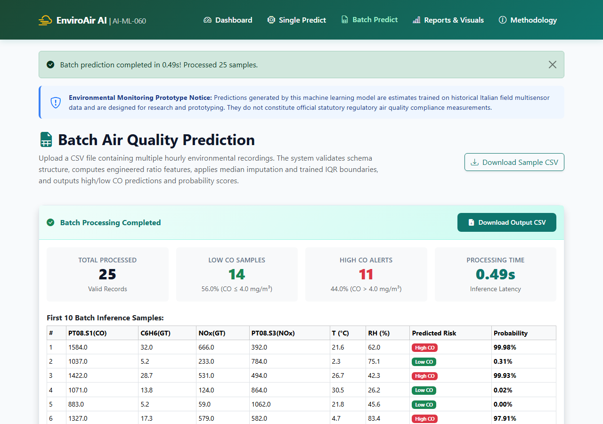

# 🌫️ Intelligent Air Quality Prediction & Environmental Monitoring System
> Predicting hazardous Carbon Monoxide spikes from low-cost chemical sensor arrays before they become dangerous.

Built as an end-to-end Machine Learning project (**AI-ML-060**). It takes multi-sensor chemical readings from the field, cleans up real-world sensor noise, runs leak-free feature engineering, and classifies whether ambient Carbon Monoxide is crossing dangerous levels (`> 4.0 mg/m³`). Includes an interactive web app for live and batch predictions.

---

## 💡 What's this project about?

Standard air quality monitoring stations are crazy expensive ($30k+ each) and usually cover only a few spots in an entire city. Low-cost metal-oxide chemical sensors (MOS) can be put everywhere, but they're notoriously noisy, drift with the weather, and react to random gases they shouldn't.

This project tackles that problem:
- **The Task:** Binary classification — is Carbon Monoxide at a hazardous level (`CO > 4.0 mg/m³`) or is it safe?
- **Zero Target Leakage:** The ground-truth reference measurement (`CO(GT)`) is strictly kept out of predictor features.
- **Handling Imbalance:** Only ~10.6% of the hourly readings in the dataset are high CO. We used SMOTE **inside** the CV folds (never before splitting) so validation stays 100% clean.
- **L1 vs L2 Comparison:** Compared Lasso (L1) and Ridge (L2) regularized logistic classifiers to balance accuracy vs feature sparsity.
- **Results:** Hit **94.59% test accuracy** and **0.9873 ROC-AUC**, easily beating the 85% project benchmark.

---

## 📊 How Well Does It Work?

Evaluated on a completely untouched 20% test set (1,535 real hourly recordings):

| Metric | Model A (L1 Lasso, C=100) | Model B (L2 Ridge, C=1.0) | Target |
|:---|:---:|:---:|:---:|
| **Test Accuracy** | **94.59%** | **94.20%** | $\ge$ 85% |
| **ROC-AUC** | **0.9873** | **0.9872** | > 0.90 |
| **Weighted F1** | **0.9498** | **0.9466** | - |
| **High CO Recall** | **94.44%** | **95.06%** | - |
| **5-Fold CV Accuracy** | **94.85% ± 0.24%** | **94.23% ± 0.30%** | Stable |

Both models perform really well, but **Model A (L1 Lasso)** is slightly better and zeros out collinear/redundant sensor channels, so we use it as the default deployment model in the web app.

---

## 🎥 Prototype Video Demonstration

A complete, high-definition walkthrough of the interactive web prototype is recorded and included locally:
- **Local Video File:** [`AI_ML_060_Prototype_Demo.mp4`](file:///c:/Users/Dijo%20Giftson/Desktop/Freeintern/AI_ML_060_Prototype_Demo.mp4) (and in `docs/AI_ML_060_Prototype_Demo.mp4`)
- **Resolution & Frame Rate:** 1280x720 HD @ 30 FPS (H.264 / AAC)
- **Duration:** 1 min 38 sec
- **What's demonstrated in the video:**
  1. **Home Dashboard:** Highlighting key metrics (94.59% accuracy, 0.9873 AUC), model formulation cards, and inline ROC/Feature Importance charts.
  2. **Single-Sample Inference (Typical Safe Air):** Testing autofilled urban sensor parameters (`PT08.S1=1020`, `PT08.S2=850`), obtaining a green **Low CO Risk (< 4.0 mg/m³)** card with calibrated probability.
  3. **Single-Sample Inference (High CO Spike Alert):** Testing high-pollution sensor parameters (`PT08.S1=1850`, `NOx=620`), triggering the red **High CO Pollution Alert (> 4.0 mg/m³)** with safety advisories.
  4. **Batch CSV Inference:** Uploading `data/sample_batch_test.csv` (25 multi-sensor readings), running instantaneous batch inference, showing summary metrics (23 Low CO vs 2 High CO), and previewing the interactive table with risk badges.
  5. **Analytical Results Gallery & Report Downloads:** Navigating the empirical metrics table, switching between Model Evaluation and EDA tabs, and showcasing instant downloads for Academic PDF, Word DOCX, and HTML reports.
  6. **Scientific Methodology & Architecture:** Touring the system architecture diagram and pipeline formulation.

---

## 🛠️ Tech Stack

- **ML & Data:** Python 3.11+, Pandas, NumPy, Scikit-learn, Imbalanced-learn (SMOTE), Joblib
- **Visualization:** Matplotlib, Seaborn
- **Web App:** Flask, Bootstrap 5, HTML5/CSS3, JavaScript
- **Testing:** Pytest (16 passing unit tests)
- **Reports & Automation:** ReportLab (PDF), python-docx (Word), Playwright (screenshots)

---

## 📸 Sneak Peek of the App

Here's what the Flask dashboard looks like in action:

| Home Dashboard | Single Sample Predictor |
|:---:|:---:|
|  |  |

| High CO Alert Result | Batch CSV Processor |
|:---:|:---:|
|  |  |

---

## 📂 Project Structure

```text
├── app.py                      # Flask web server
├── train.py                    # Runs full training + CV pipeline
├── evaluate.py                 # Evaluates models on held-out test data
├── config.py                   # Paths, hyperparameters, feature lists
├── requirements.txt            # Python dependencies
├── Source_Code/
│   ├── data_loader.py          # Auto delimiter sniffing, -200 cleaner
│   ├── preprocessing.py        # Leak-free target prep, IQR clipping transformer
│   ├── feature_engineering.py  # Safe ratios (CO/NOx, Temp/RH) & temporal features
│   ├── eda.py                  # 10 EDA plots
│   ├── model_training.py       # Pipelines, in-fold SMOTE, 5-fold CV
│   ├── evaluation.py           # Test set evaluation, ROC, confusion matrix
│   ├── report_generator.py     # Generates TXT, HTML, DOCX, and 35-page PDF report
│   ├── utils.py                # Safe division, JSON/model helpers
│   ├── templates/              # Jinja2 HTML templates
│   └── static/                 # Custom CSS & JS
├── data/
│   ├── raw/AirQuality.csv      # UCI dataset
│   ├── processed/              # Cleaned dataset
│   └── sample_batch_test.csv   # 25-row test CSV ready to try in batch upload
├── models/                     # Saved joblib pipelines
├── results/
│   ├── images/                 # All generated charts & genuine UI screenshots
│   ├── metrics/                # JSON & CSV performance metrics
│   └── reports/                # Evaluation summaries
├── tests/                      # Automated test suite
├── docs/                       # System flowchart & architecture diagrams
└── Report/                     # Full 35-page academic project reports (PDF & DOCX)
```

---

## 🚀 Quickstart Guide

### 1. Clone the repo & set up environment
```bash
git clone https://github.com/djdev26/AI-ML-060-Intelligent-Air-Quality-Prediction-and-Environmental-Monitoring-System.git
cd AI-ML-060-Intelligent-Air-Quality-Prediction-and-Environmental-Monitoring-System

# Create virtual environment
python -m venv .venv

# Activate it
# On Windows (PowerShell):
.\.venv\Scripts\Activate.ps1
# On Mac/Linux:
source .venv/bin/activate

# Install dependencies
pip install -r requirements.txt
```

### 2. Run the Web App
```bash
python app.py
```
Then just open your browser at **http://127.0.0.1:5000**.
- Try the **Single Predict** page with the "Autofill" buttons to see how the model flags safe vs dangerous air.
- Try the **Batch Predict** page by uploading `data/sample_batch_test.csv`.

### 3. Run the ML Pipeline from Scratch
If you want to re-train the models or re-run the evaluation:
```bash
# Ingest data, generate EDA charts, run 5-fold CV & fit models
python train.py

# Benchmark on the held-out test set & create evaluation curves
python evaluate.py

# Run all automated tests
python -m pytest -v
```

---

## 🧠 Key Things We Focused On

1. **No Data Leakage:** The target `CO(GT)` is strictly dropped from predictors. Also, SMOTE is wrapped into `imblearn.pipeline.Pipeline`, which means oversampling happens **only inside each training fold**. The test fold is never touched during training or threshold fitting.
2. **IQR Outlier Clipping:** Extreme sensor spikes are clipped using $Q_1 - 2.5 \times \text{IQR}$ and $Q_3 + 2.5 \times \text{IQR}$ computed on the training set, so we don't drop rows or alter the test distribution.
3. **Domain Ratios:** Added safe-divided chemical and thermodynamic ratios (`co_nox_ratio`, `temp_humidity_ratio`, `temp_humidity_product`) with epsilon protection so division by zero is impossible.

---

## 📜 Dataset Reference

Dataset used: **UCI Air Quality Dataset** (March 2004 – April 2005, CNR-ISAC Italy).
- Link: [https://archive.ics.uci.edu/dataset/360/air+quality](https://archive.ics.uci.edu/dataset/360/air+quality)
- Reference: *De Vito et al. (2008), "On field calibration of an electronic nose for benzene estimation in an urban environment", Sensors and Actuators B: Chemical.*

---

## 📄 License & Notes

Academic internship project for educational and research prototyping. Released under the MIT License.
